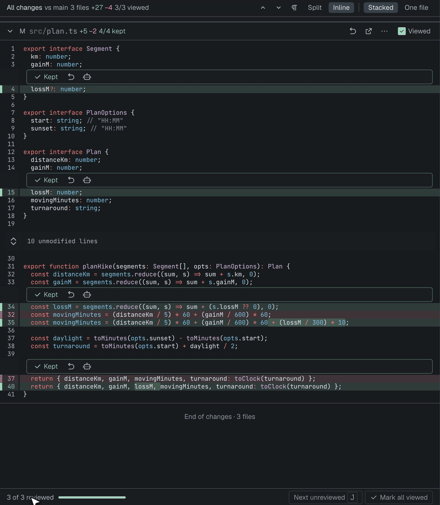
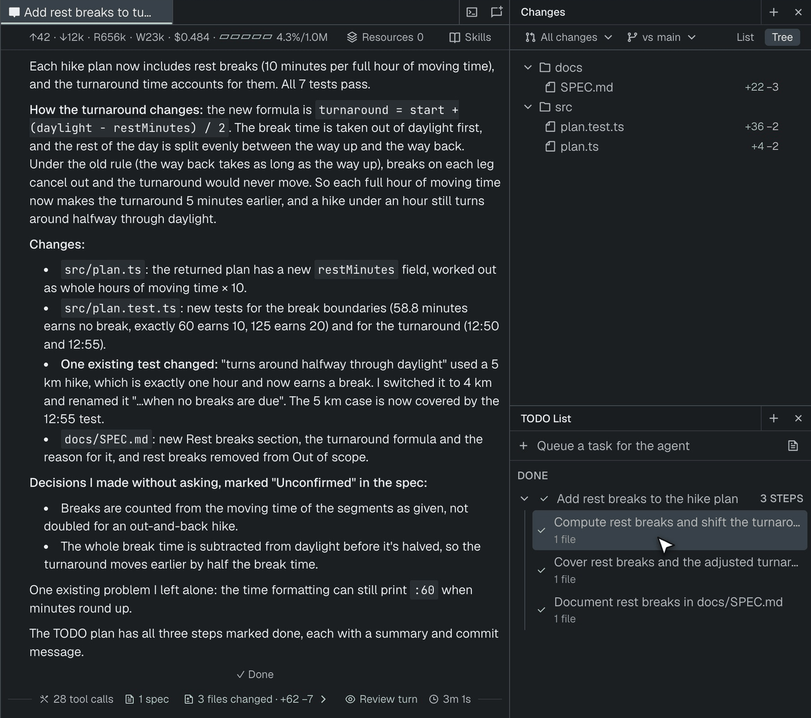
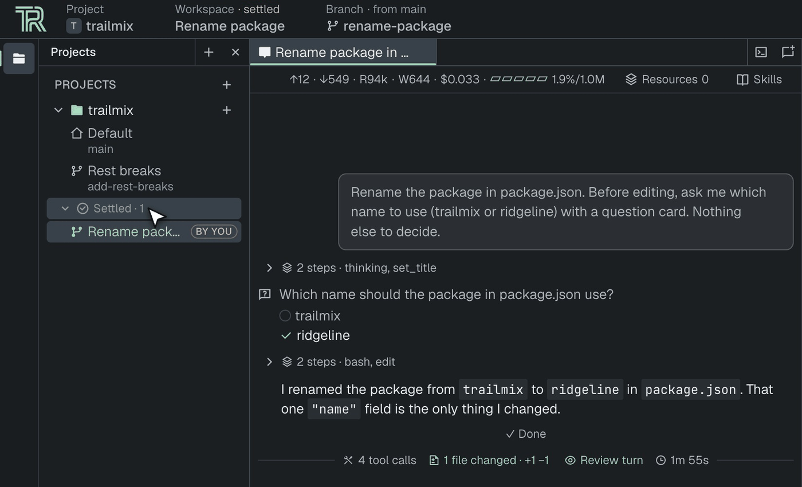
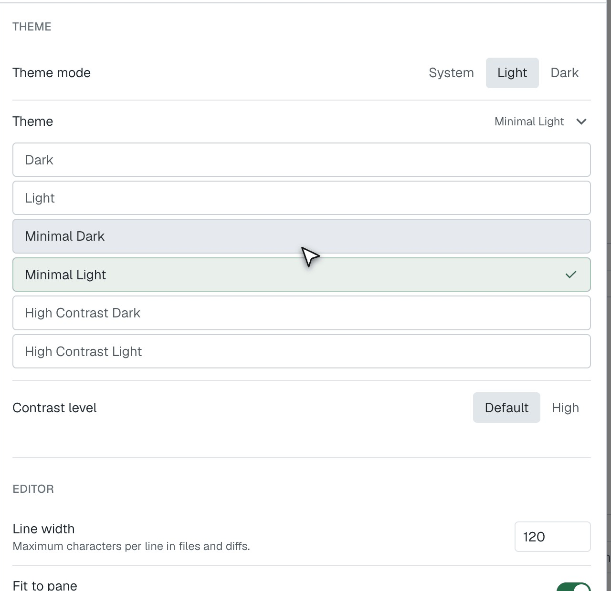

[RealThing](https://realthing.ai/?utm_source=blog&utm_medium=organic-social&utm_campaign=release-0-2-0) 0.2.0 is out, introducing streamlined multi-scope diff review, a dedicated workspace plan rail, automatic workspace settling, and two new minimal themes.

## Streamlined diff review

On the branch diff (**All changes**), each hunk gets **Keep** and **Revert** actions. Keeping the last hunk of a file marks it viewed, the progress bar fills up, and **Next unreviewed** (`J`) takes you to the next file you haven't read. If you prefer going file by file, **One file** is a view mode of the same tab, so switching keeps your progress.

## The plan moved to a rail

The workspace TODO plan now lives in a **Plan** side rail next to Files and Changes, with a full center-tab Plan view one click away.

## Finished workspaces park themselves

Each project now has a **Settled** shelf. A workspace moves there after 7 idle days (configurable under Settings › Workspaces: 1, 3, 7, 14, or never), and **Settle** / **Keep active** let you control placement manually.

## New look

Projects, Files, Changes, and Plan live in edge tool rails with a denser layout, redesigned Settings, and two new themes: **Minimal Light** and **Minimal Dark**.

Happy developing!
